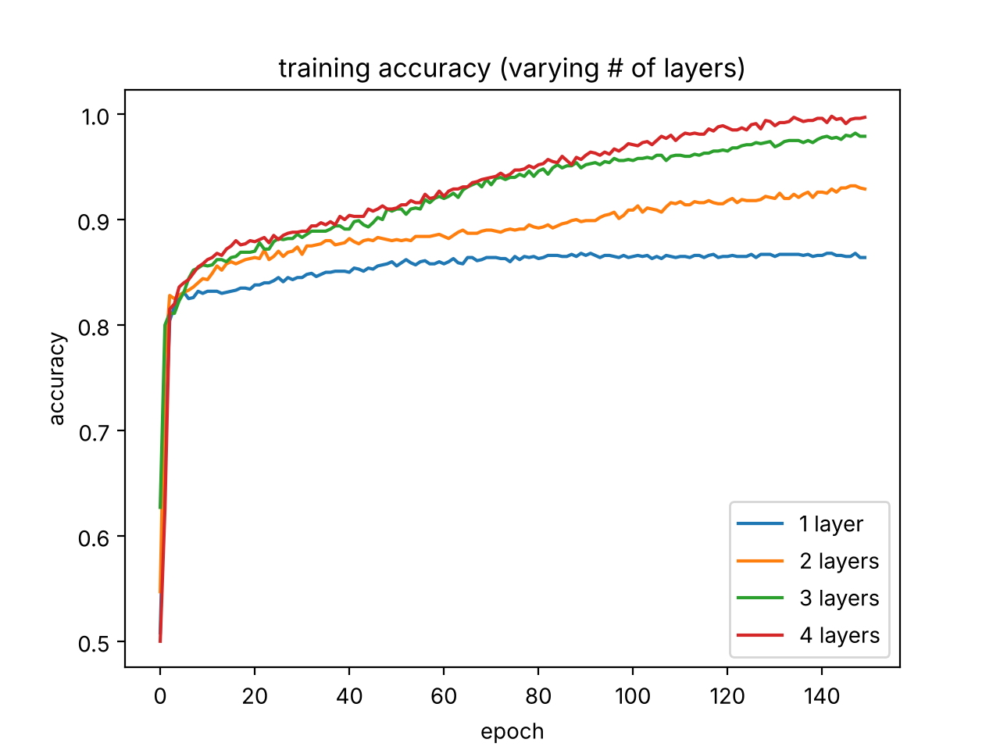
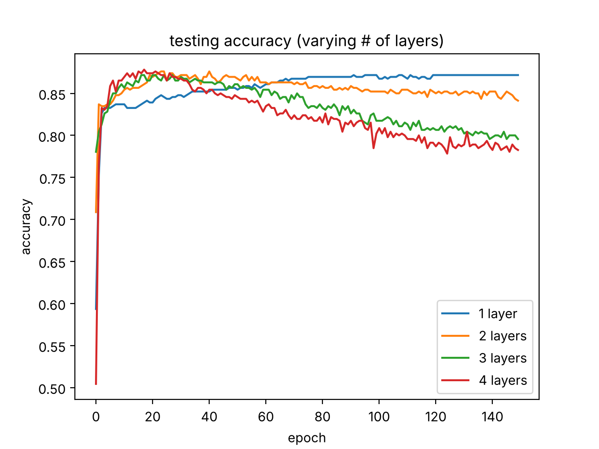
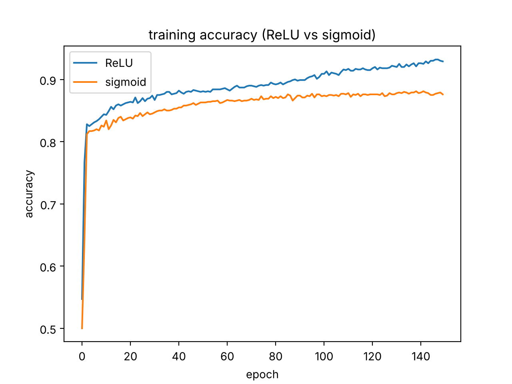
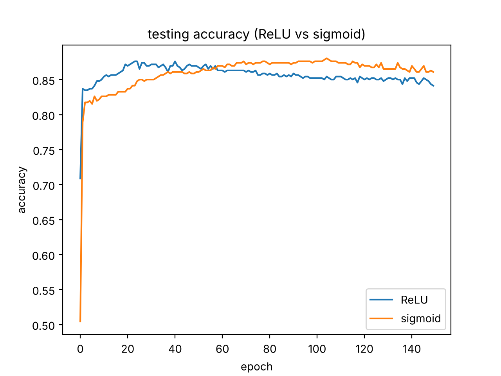
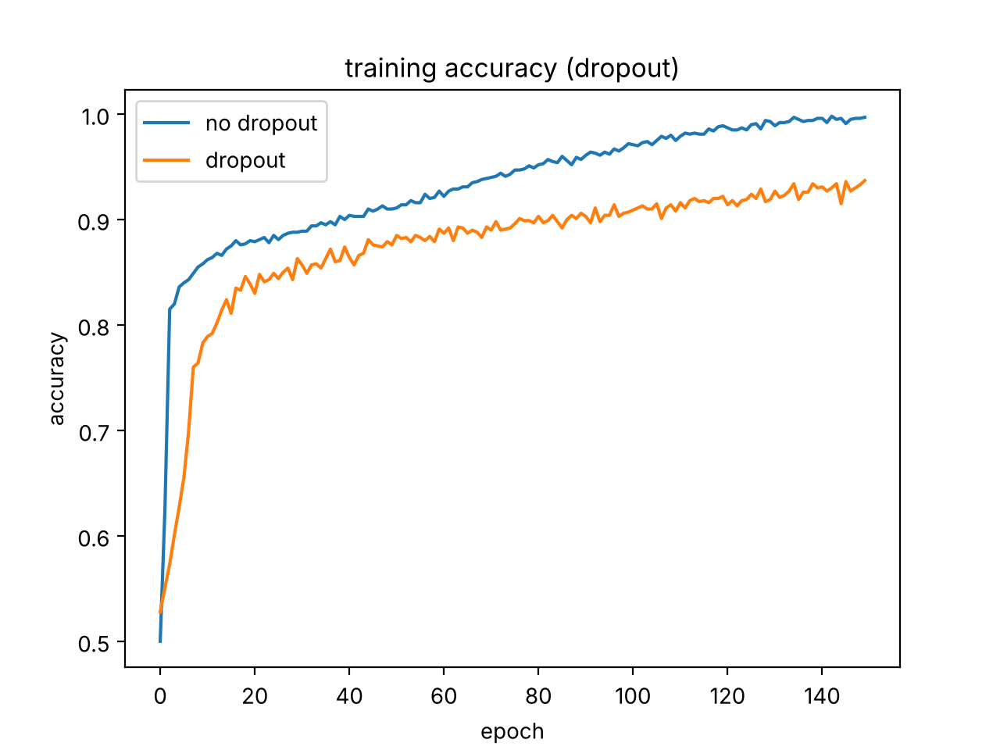
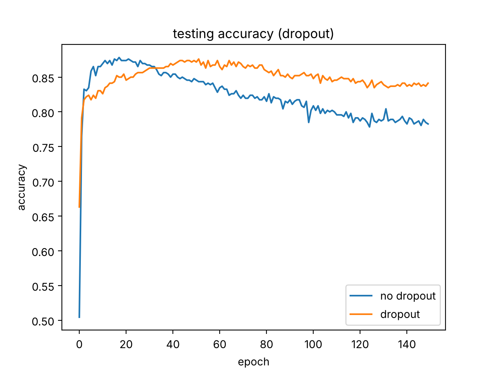

decision tree (information gain, 10-fold cross-validated split threshold) and fully connected neural network experiments (depth, relu vs sigmoid, dropout) for classifying house sale prices as high or low.

## number of layers (relu, no dropout)

## relu vs sigmoid (2 layers)

## dropout (4 layers, relu)

